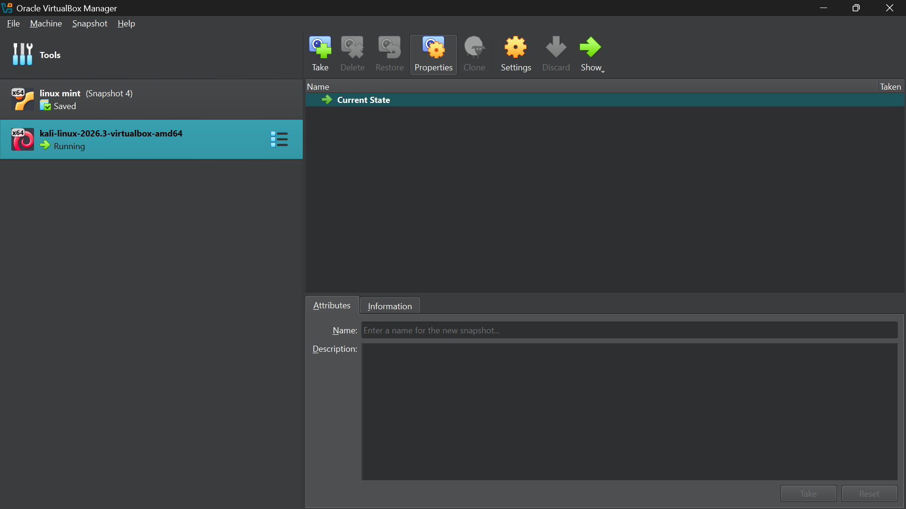
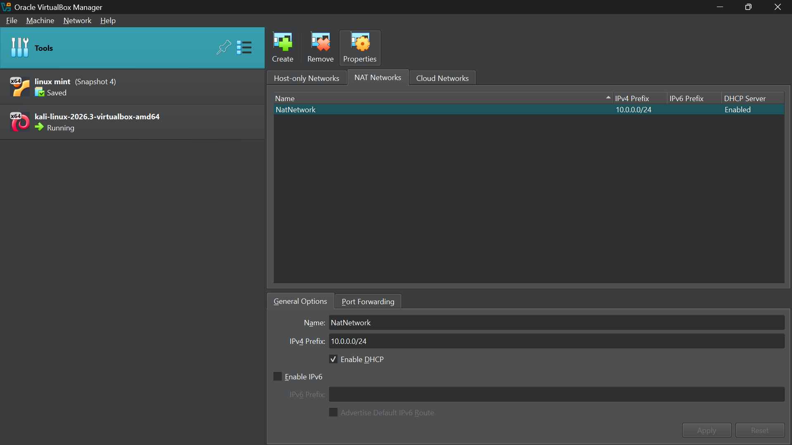
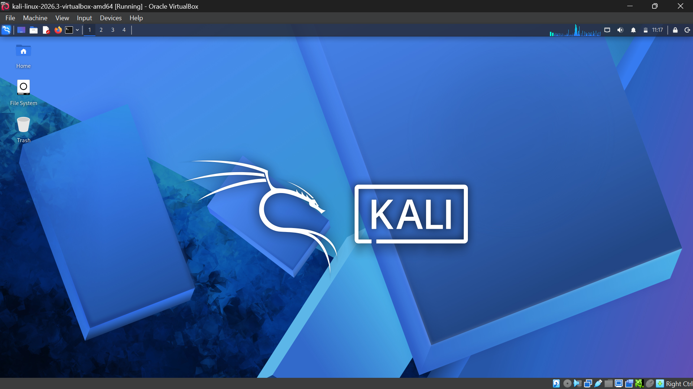
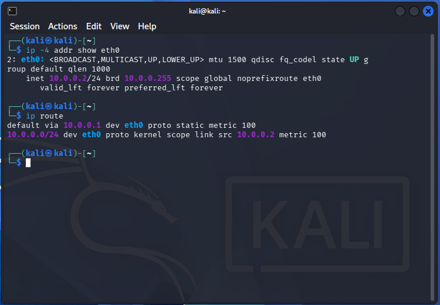
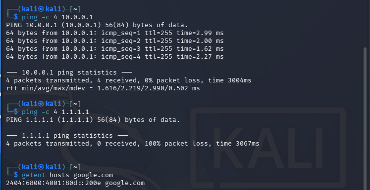

# Week 1: Cybersecurity Lab Setup

## 1. Overview

This project documents the setup and configuration of my cybersecurity lab environment using Oracle VirtualBox and Kali Linux. The purpose of this lab is to establish a virtual environment for learning and practising cybersecurity fundamentals.

## 2. Objectives

- Install and configure Kali Linux in Oracle VirtualBox.
- Configure the virtual machine's network settings.
- Assign and verify a static IP address.
- Test network connectivity and DNS resolution.
- Document the setup process with screenshots.

## 3. Lab Environment

| Component | Details |
|---|---|
| Host Operating System | Windows |
| Virtualization Software | Oracle VirtualBox |
| Guest Operating System | Kali Linux |
| Network Mode | NAT Network |
| Network Address | `10.0.0.0/24` |
| Kali Linux IP Address | `10.0.0.2/24` |
| Default Gateway | `10.0.0.1` |
| DNS Server | `10.0.0.1` |

## 4. Network Design

The virtual machine uses a NAT Network in VirtualBox to provide network connectivity.

| Setting | Configuration |
|---|---|
| Network Prefix | `10.0.0.0/24` |
| Kali IP Address | `10.0.0.2` |
| Gateway | `10.0.0.1` |
| DNS | `10.0.0.1` |

These settings describe the intended lab configuration. The actual configuration was checked using Kali Linux network commands.

## 5. Setup Procedure

1. Installed and configured Oracle VirtualBox.
2. Created and started the Kali Linux virtual machine.
3. Configured the virtual machine's network adapter.
4. Set up the intended static network configuration.
5. Checked the IP address, routing table and DNS settings.
6. Performed connectivity tests.
7. Captured screenshots as evidence of the lab setup.

## 6. Screenshots and Evidence

### Screenshot 1: VirtualBox Kali Linux VM

Shows the Kali Linux virtual machine running in VirtualBox.



### Screenshot 2: NAT Network Configuration

Shows the VirtualBox NAT Network configuration.



### Screenshot 3: Kali Linux Desktop

Shows the Kali Linux desktop environment after startup.



### Screenshot 4: Network Configuration

Shows the network configuration, including the IP address and routing information.



### Screenshot 5: Connectivity Tests

Shows the results of the network connectivity and DNS resolution tests.



## 7. Network Verification

The following commands were used to inspect the network configuration:

```bash
ip -4 addr show eth0
ip route
cat /etc/resolv.conf
```

The following commands can be used to test connectivity:

```bash
ping -c 4 10.0.0.1
ping -c 4 1.1.1.1
getent hosts google.com
```

The results should be recorded based on the actual output observed during testing.

## 8. Troubleshooting and Lessons Learned

During the setup process, I worked on configuring the virtual machine's networking and display settings. This helped me understand the importance of correct virtual network configuration, IP addressing, routing and connectivity verification.

Any unresolved issues should be documented along with the troubleshooting steps taken.

## 9. Learning Outcomes

Through this lab, I gained practical experience with:

- Virtual machine setup and management.
- Basic Linux networking commands.
- Static IP address configuration.
- Network connectivity testing.
- DNS resolution verification.
- Technical documentation and evidence collection.

## 10. References

- [Kali Linux Documentation](https://www.kali.org/docs/)
- [Oracle VirtualBox Documentation](https://www.virtualbox.org/manual/)
- [GitHub Documentation](https://docs.github.com/)
**Project:** Week 1 Cybersecurity Lab Setup  
**Status:** Update this field to reflect your actual completion status.
